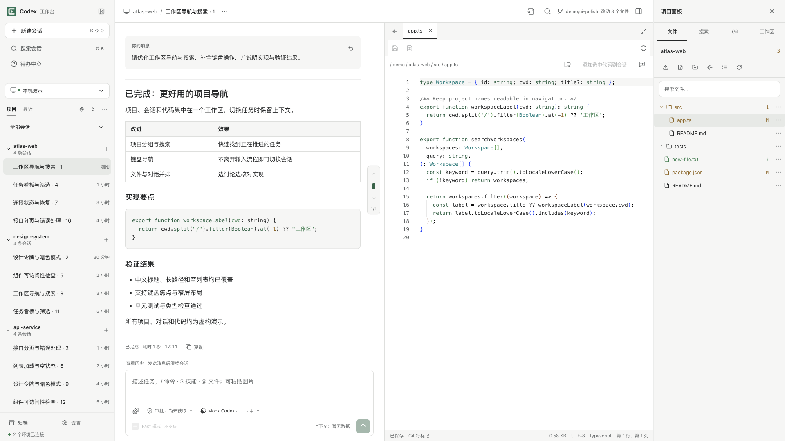
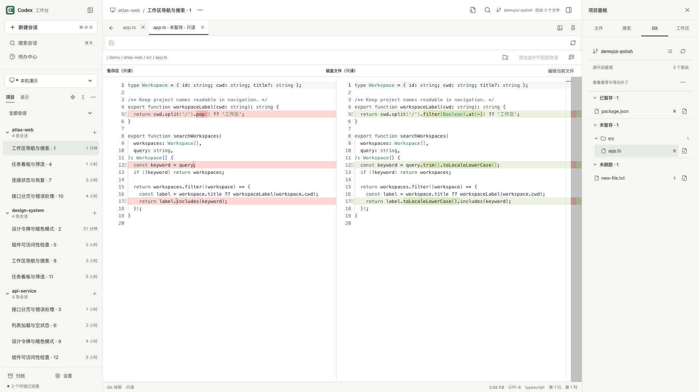
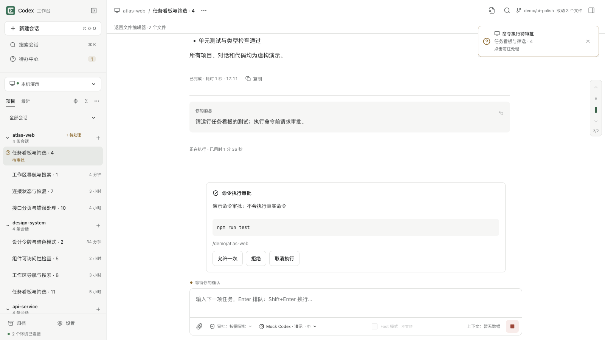
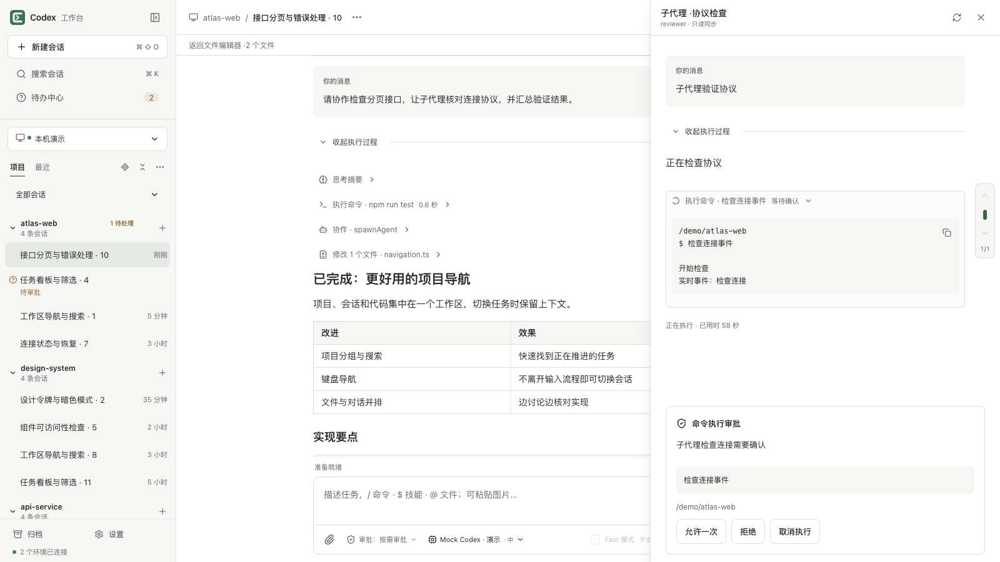
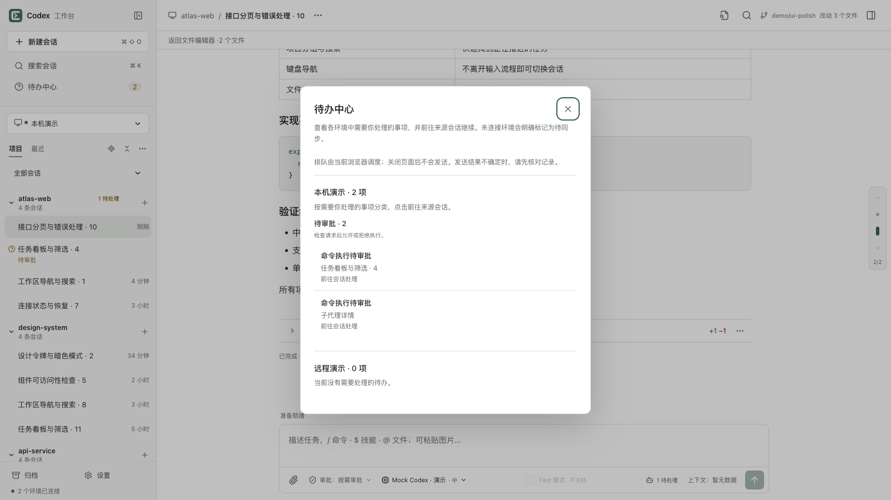

<p align="center">
  
</p>

# Codex 工作台

[English](README.md) · 简体中文

**把 Codex 的会话、任务队列、审批和子代理活动放进一个支持中英文的工作台。**

在浏览器中组织项目、跟进执行、查看代码变更，同时连接本机与通过 SSH 转发的开发环境。工作台在本机运行，通过 Codex app-server 执行任务。

[使用指南](docs/user-guide.md) · [更新日志](https://github.com/vvebing/codex-workbench/releases) · [参与开发](CONTRIBUTING.md) · [安全说明](SECURITY.md)

采用 [MIT License](LICENSE)。

## 产品预览

**从任务讨论到代码核对，在一个工作台里完成。** 按项目组织会话，连接多个工作环境，并排查看对话、编辑器与项目文件。



以下截图均使用独立环境中的虚构项目、会话与代码，不包含真实开发数据。点击图片可查看大图，展开下方场景了解特色功能。

<details>
<summary>审阅代码变更：逐行核对差异，区分已暂存、未暂存与未跟踪文件</summary>



</details>

<details>
<summary>掌握执行边界：先查看命令、原因和目录，再决定是否允许执行</summary>



</details>

<details>
<summary>跟进子代理协作：在主会话旁查看执行输出并处理子代理审批</summary>



</details>

<details>
<summary>集中处理待办：按工作环境汇总需要确认的事项，直接返回来源会话</summary>



</details>

## 功能亮点

| 功能         | 你可以做什么                                             |
| ------------ | -------------------------------------------------------- |
| 多环境工作区 | 同时连接本机和远端开发机，按环境、项目和分区组织会话     |
| 会话与历史   | 搜索、收藏、分叉、归档会话，复制或导出 Markdown          |
| 消息队列     | 在任务执行期间继续编辑和排队，查看发送状态并恢复失败草稿 |
| 审批与协作   | 处理审批、回答请求，跟踪子代理活动和任务进度             |
| 代码与上下文 | 引用文件和技能，查看代码差异，使用会话目标和代码审查     |
| 文件工作区   | 上传、下载项目文件，定位当前文件，引用文件与选中代码     |
| 本机运行     | 一条 npx 命令启动网页服务，自动启动或复用本机 app-server |

会话与编辑器在主区域宽度达到 960px 时可并排显示，首次默认各占一半；拖动分隔线会记住比例，双击或按 Enter 恢复均分。右侧文件列表支持“跟随当前编辑器”，也可从编辑器工具栏或标签页右键定位文件。

文件面板支持多文件上传与单文件下载，每个文件最多 8 MB；同名上传可替换、保留两者或取消。下载有未保存修改的文件时，可选择保存后下载或下载磁盘版本。

输入框可添加图片和其他文件附件（每个最多 5 MB），也可从文件树拖入项目文件引用。非图片附件保存到项目 `.codex-workbench/attachments/` 并作为路径引用；移除引用会保留文件，具体文档格式的解析取决于运行环境工具。

文本编辑器支持查看最多 8 MB 的 UTF-8 文件：1 MB 以内正常编辑，超过 1 MB 至 5 MB 使用纯文本简化模式，超过 5 MB 至 8 MB 只读查看。简化模式关闭语法高亮、Markdown 渲染、差异比较和 Git 行标记；行数超过 2 万或单行超过 2 万字符的文件也会自动简化。Git 差异仍限制为 256 KB。编辑内容超过 5 MB 时保留撤销历史，但需缩减后才能保存。

较大的未保存草稿使用 IndexedDB 异步恢复存储，停止输入后约 400ms 写入，并显示保存状态；离开页面前请确认草稿已保存到浏览器，或直接保存到文件。浏览器存储不可用时会提示，清除站点数据会删除本地恢复副本。

## 快速开始

界面默认跟随浏览器语言：中文浏览器显示简体中文，其他语言显示英文。在「设置 → 通用 → 语言」中可选择跟随浏览器、English 或简体中文；选择会保存在当前浏览器，切换立即生效。界面语言不会翻译用户消息、模型回复或文件内容。

需要 **Node.js 22.12+**，以及已安装并完成登录的 Codex CLI。npm 包首次发布后，可直接运行：

```sh
npx codex-workbench@latest
```

打开 **http://127.0.0.1:5180** ，在「设置 → 工作环境」连接默认的 `ws://127.0.0.1:4501`。也可以指定网页端口：

```sh
npx codex-workbench@latest --port 5181

# 或安装为常用命令
npm install -g codex-workbench
codex-workbench --port 5181
```

| 参数                | 说明                                        |
| ------------------- | ------------------------------------------- |
| `-p, --port <port>` | 网页端口；优先于 `PORT` 环境变量，默认 5180 |
| `--no-app-server`   | 仅启动网页服务，自行管理 app-server         |
| `-h, --help`        | 显示帮助                                    |
| `-v, --version`     | 显示已安装版本                              |

网页服务仅监听 `127.0.0.1`。`--port` 不改变 app-server 端口；不同网页端口的浏览器本地配置相互独立。远端连接与数据保存方式见[使用指南](docs/user-guide.md)。

## 从源码开发

```sh
npm ci
npm run patch:release-tools
npm run dev
```

开发模式需在另一个终端启动 app-server：

```sh
codex app-server --listen ws://127.0.0.1:4501
```

## 生产运行

这里的“生产运行”指本机发行构建，不是公网或多人服务。发布前请完成[发布检查清单](docs/release.md)，安全边界与敏感数据处理见[安全说明](SECURITY.md)。不要通过反向代理或公网隧道暴露工作台。

先停止占用相同端口的开发服务，再构建和启动：

```sh
npm ci
npm run patch:release-tools
npm run build
npm start
```

构建产物位于 `dist/client/` 和 `dist/server/`。生产服务运行编译后的 JavaScript，默认监听 **127.0.0.1:5180**；使用 `npm start -- --port 5182` 或 `PORT=5182 npm start` 修改端口。网页和 `/bridge` 共用一个端口，`GET /healthz` 返回网页服务的存活状态。

向独立运行目录交付时，保留 `dist/`、`package.json`、`package-lock.json` 和 `.npmrc`，执行 `npm ci --omit=dev` 后即可 `npm start`。`npm start` 会自动执行 `codex app-server --listen ws://127.0.0.1:4501`；若该端口已有服务则直接复用。找不到 `codex` 或子进程启动失败时会输出提示，网页服务继续运行，可连接其他 app-server。健康检查仅代表网页服务可用。在「设置 → 终端输出」可查看该进程的 stdout、stderr 和启动提示（最近 128 KiB）；输出仍会同步到启动 `npm start` 的终端。复用外部进程时无法读取其输出。

当前服务面向本机使用，监听和 Host／Origin 校验均限制为 loopback；远端执行通过 SSH 转发连接。停止 `npm start` 会关闭它启动的 app-server，不会停止用户原先运行的服务。`npm run dev` 不会启动或停止 app-server，开发时仍需手动运行。

## macOS 后台运行

使用 launchd 在登录后自动启动生产构建，并在进程异常退出后自动重启。先完成构建，再安装服务：

```sh
npm run build
npm run daemon:install
npm run daemon:status
```

`npm run daemon:start` 启动服务，`daemon:stop` 停止服务，`daemon:restart` 重新生成配置并重启，`daemon:logs` 持续查看日志（Ctrl+C 退出），`daemon:uninstall` 停止并移除服务。`npm run daemon` 查看命令帮助。

服务标识为 `com.codex-workbench`，配置保存于 `~/Library/LaunchAgents/com.codex-workbench.plist`，日志位于项目的 `logs/start.out.log` 和 `logs/start.err.log`。后台直接使用安装时的 Node 运行 `dist/server/index.js`，启动行为与 `npm start` 相同。安装或重启时保存当前 PATH 和 PORT，例如 `PORT=5182 npm run daemon:install`；无需 `.env`。更新代码后运行 `npm run build && npm run daemon:restart`；移动项目或更换 Node 安装位置后也需重新安装服务。卸载保留日志。

## 开发与验证

```sh
npm run check
npm run test:e2e
npm run build
E2E_PRODUCTION=1 npm run test:e2e
```

`check` 包含提交内容检查、类型检查、lint、格式检查和单元／集成测试。首次运行浏览器测试可先执行 `npx playwright install chromium`。E2E 使用独立网页端口 **5181** 和随机端口的协议替身，不执行真实 Codex 推理或 SSH。默认验证开发模式；设置 `E2E_PRODUCTION=1` 后验证编译后的 HTTP 服务与客户端，并启用生产分包检查。生产 E2E 使用专用启动器，不启动、复用或读取用户的真实 app-server。真实 app-server 的非推理烟测可通过 `npm run test:app-server` 单独运行。

[使用指南](docs/user-guide.md)介绍连接、会话、队列与数据保存；[开发与维护](docs/development.md)说明目录职责、协议边界和测试方式；[接口覆盖清单](docs/app-server-coverage.md)列出已接入功能和暂缓范围。
