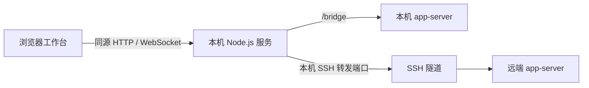

# 架构说明

Codex Workbench 是单用户、本机运行的浏览器工作台。浏览器负责界面和交互状态，Node.js 服务提供静态文件与协议转发，Codex app-server 负责会话、模型任务、文件访问和命令执行。

## 运行拓扑

网页服务默认监听 `127.0.0.1:5180`。生产入口可启动或复用 `127.0.0.1:4501` 的 app-server；开发入口只提供网页和 bridge。只有工作台自己启动的子进程会随工作台退出。`/healthz` 仅表示网页服务存活。

浏览器不直接连接 app-server。它连接同源 `/bridge`，首帧提交端点和可选 Token；bridge 建立上游 WebSocket 并透传 JSON 文本帧，保留请求 ID、通知和审批响应。Token 作为上游 `Authorization: Bearer …` 发送。bridge 不重放断线时的变更请求。

## 环境与状态

`src/lib/runtime.ts` 为每个环境组合 connection、sessions、requests、drafts、submissions 和 queue。状态按环境隔离；连接 epoch 与选择 generation 用于拒绝过期异步结果。切换环境、会话或目录后，旧请求不能覆盖当前界面。

- **连接**：维护端点、初始化、账户与能力发现。断线撤销写入能力。
- **会话**：历史读取与执行写入分离。`thread/read` 用于查看；发送前通过 `thread/resume` 确认 writer。`threadAccess` 表示写入能力，`active` 表示执行状态。
- **草稿与提交**：新会话入口先保存本地草稿，首次发送创建 thread 和 turn。发送快照与草稿 revision 保护提交期间的新输入；提交状态位于环境级 store。
- **请求**：服务端审批和问题存放在独立 request store，主会话和子代理观察界面共享来源。
- **队列**：保存输入与配置快照，按环境、端点和会话隔离。IndexedDB 持久化，Web Locks 串行化跨标签页写入和发送，BroadcastChannel 同步变化。恢复与重连后先暂停，结果不确定时由用户核实。

## 历史与实时事件

`src/lib/state.ts` 归并历史快照与实时事件，较旧的读取结果不能回退已有内容或完成状态。会话轮询串行执行，断线停止，后台环境和隐藏页面降低频率。

子代理观察器由列表和详情共享，无订阅者时释放监听与计时器，完成后停止补读。通知根据服务端的父线程身份和来源过滤；未知线程先补读身份。只读历史读取本身不等于事件订阅。

## 数据位置

| 数据                                   | 保存位置                     |
| -------------------------------------- | ---------------------------- |
| 环境偏好、显示设置、普通输入草稿       | 当前网页 origin 的浏览器存储 |
| 待发送队列、附件记录、大型文件恢复草稿 | IndexedDB                    |
| 连接 Token                             | 页面内存，不持久化           |
| 会话历史、认证与执行配置               | 对应 app-server 管理的环境   |
| 上传附件的文件内容                     | 对应执行环境中的附件目录     |
| 项目文件与 Git 工作区                  | 对应执行环境的文件系统       |

网页端口变化会改变浏览器 origin；清除站点数据会清除本地偏好与恢复副本，不会清除 app-server 的历史。文件访问通过 app-server 协议完成，项目目录不作为 HTTP 静态资源公开。

## 服务端职责

| 模块                         | 职责                                 |
| ---------------------------- | ------------------------------------ |
| `server/index.ts`、`cli.ts`  | 启动、参数与退出处理                 |
| `server/http.ts`             | 静态资源、SPA 路由和健康检查         |
| `server/bridge.ts`           | WebSocket 转发、握手、心跳与缓冲限制 |
| `server/request-policy.ts`   | loopback Host 和 Origin 校验         |
| `server/security-headers.ts` | 开发与生产共用安全响应头             |
| `server/app-server.ts`       | 本机 app-server 子进程生命周期与输出 |
| `server/codex-release.ts`    | 官方稳定版本查询与缓存               |

bridge 的握手超时默认为 10 秒，心跳间隔为 30 秒，单帧和缓冲区限制为 16 MiB。上游仅接受 `ws://` 或 `wss://`，拒绝 URL 内嵌凭据、片段和重定向。完整信任边界见[安全说明](../SECURITY.md)。
